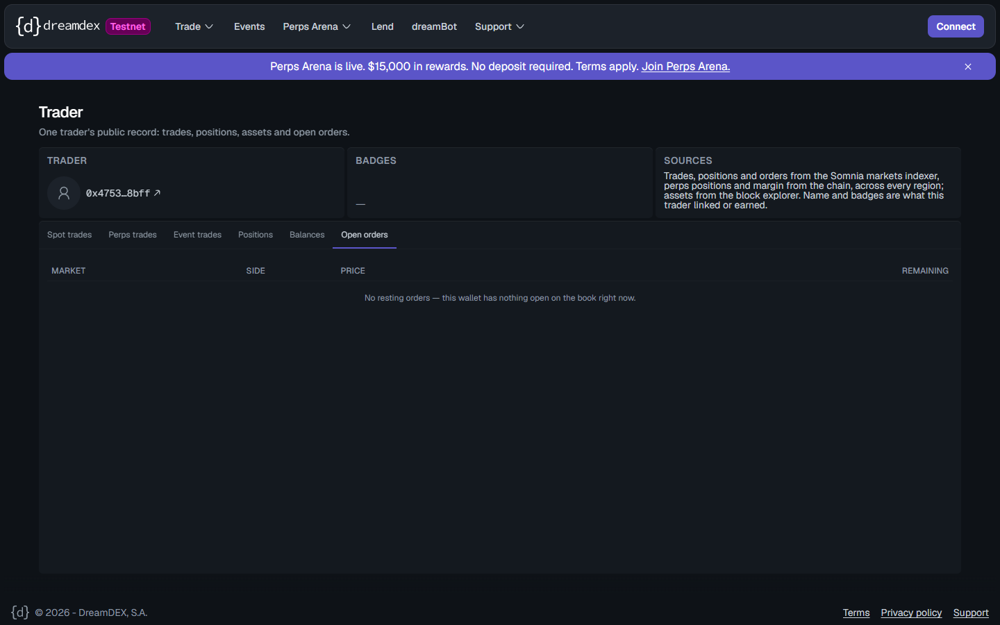
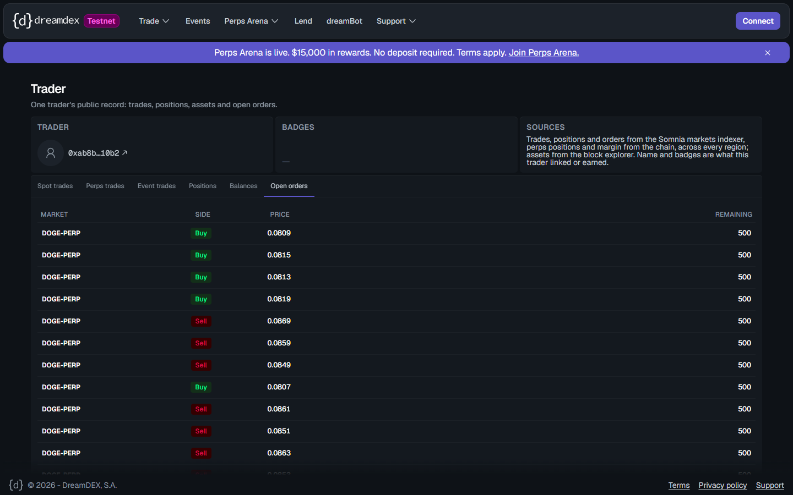
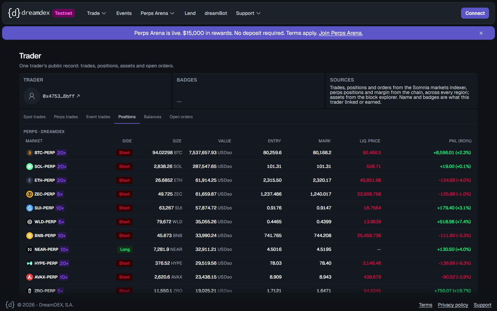

# Trader page "Open orders" shows only Global-network orders; resting perps orders on Tokyo are missing
Severity: normal
Area: app

## Steps to reproduce
1. Open https://app.testnet.dreamdex.io/trader/0x47537e3a3ea6e9391f3b26ea45618db6828c8bff?tab=orders (no login needed).
2. Count the same account's resting perps orders on Tokyo: `client.getOwnOpenOrdersOnchain(pool, account)` for each of the 21 pools, or `client.getOpenOrders(account)` against https://hideki-dev.smk.somnia.host/v1/graphql.

## Expected
The account's resting perps orders. The page's own Sources box says "Trades, positions and orders ... across every region".

## Actual
- The page shows "No resting orders — this wallet has nothing open on the book right now." (15:31 UTC, 2026-10-26).
- On chain at block 33764677 (15:30:23 UTC): **177 open orders** across all 21 perp pools (BTC 20, SOL 10, ETH 9, …), and the Tokyo indexer also returns 177.
- The page's network log shows GraphQL requests only to `dev.smk.somnia.host` (Global, chain 50312), never to `hideki-dev.smk.somnia.host`.

A second account, https://app.testnet.dreamdex.io/trader/0xab8b612548cc3f5f9f7e723823be37058d0110b2?tab=orders, shows DOGE-PERP orders at 0.0807–0.0869, buys included, though Tokyo DOGE marks 0.0776. Those are Global-network orders. Its 141 Tokyo orders (block 33765510) are missing, including its 10 DOGE orders at 0.0776–0.0782.

## Evidence
-  
- Chain counts above.
- In the app bundle, the Open orders tab (`eW` → `eq`) calls `client.getOpenOrders` on the single default client.
- The Positions tab of the same page does show this account's Tokyo positions ("PERPS · DREAMDEX", BTC, SOL, ETH, ZEC …): 

## Environment
Chrome (Playwright), logged out · app.testnet.dreamdex.io · Hideki testnet (50383) · 2026-10-26
