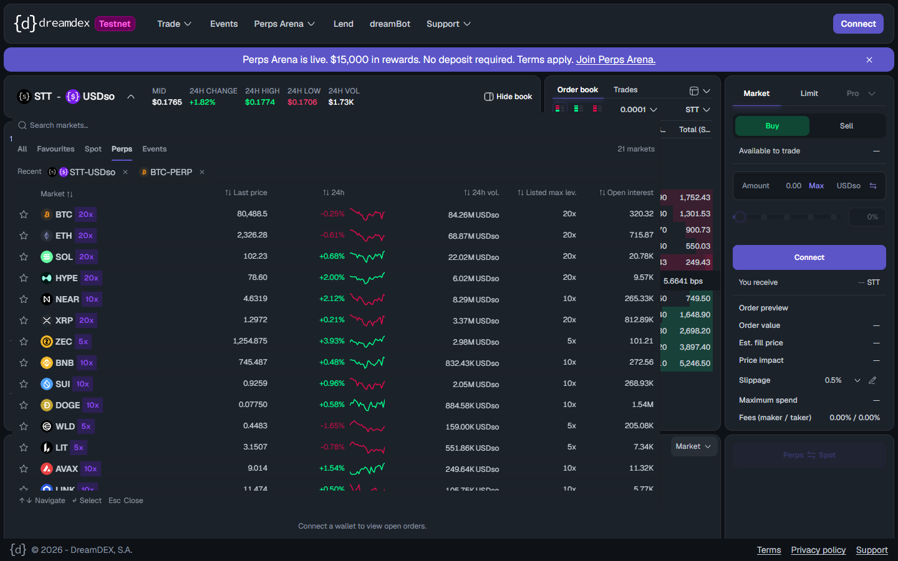
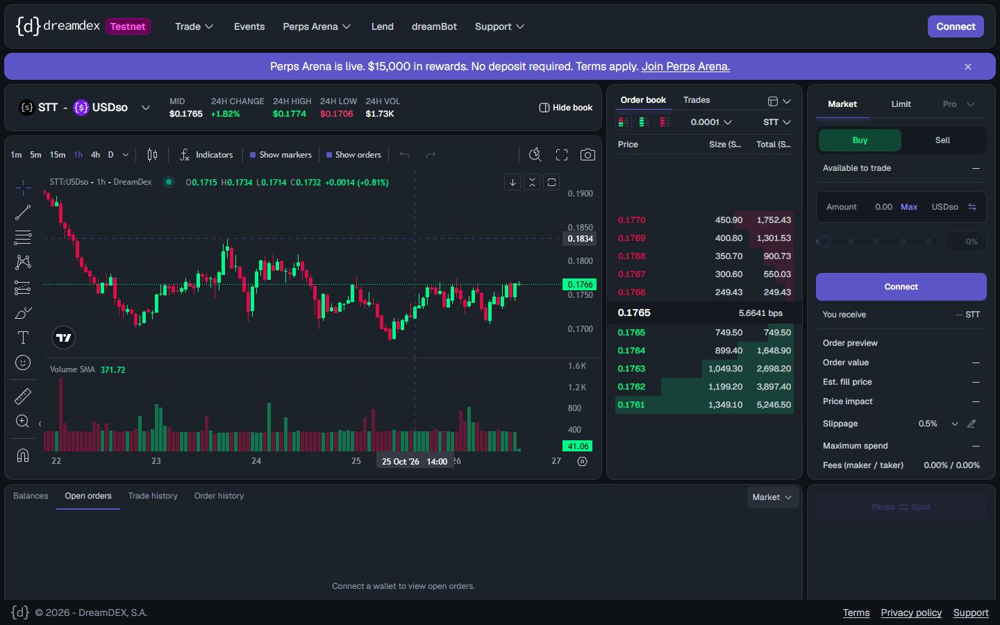

# Logged out, the app lists all perps markets but every perps link silently lands on STT spot
Severity: normal
Area: app

## Steps to reproduce
Logged out:
1. Open the market selector → Perps tab. All 21 markets are listed with price, volume and OI. Click BTC.
2. Or Trade menu → Perps.
3. Or `curl -s -o /dev/null -w "%{http_code} -> %{redirect_url}" https://app.testnet.dreamdex.io/trade/perps/tokyo/BTC-PERP`

## Expected
The perps market, or a prompt to connect or join (the app has an `/enroll` page), instead of a silent switch to a spot market.

## Actual
```
307 -> https://app.testnet.dreamdex.io/trade/spot/tokyo/STT:USDso   /trade/perps/tokyo/BTC-PERP
307 -> https://app.testnet.dreamdex.io/trade/spot/tokyo/STT:USDso   /trade/perps/tokyo/ZEC-PERP
```
In the UI the click does nothing visible: the user stays on (or is moved to) STT/USDso spot with no message. Shared perps links behave the same.

## Evidence
-  
- curl output above, 2026-10-26.

## Environment
Chrome (Playwright) and curl, logged out · app.testnet.dreamdex.io · 2026-10-26
