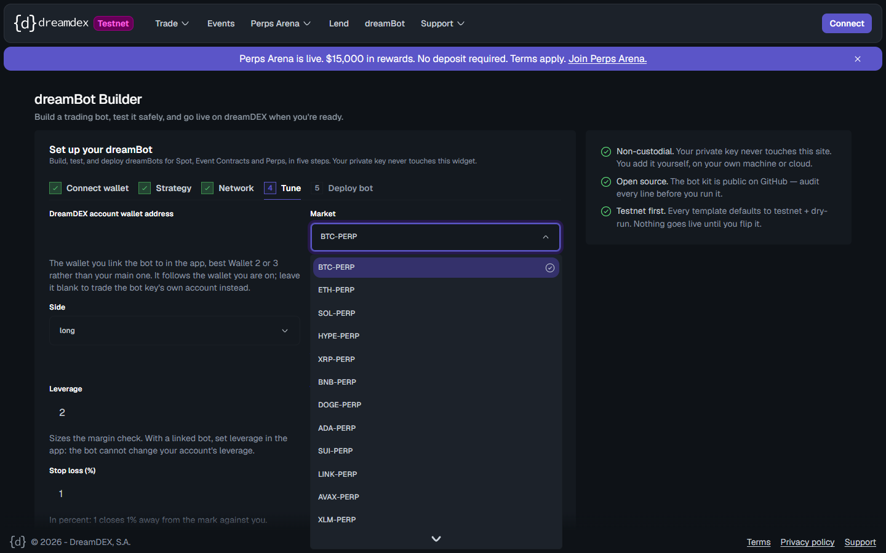
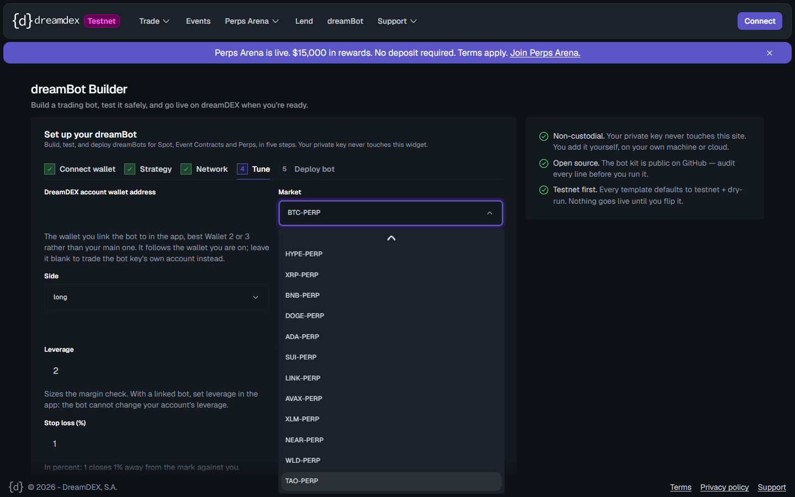

# dreamBot Builder offers only 15 of the 21 live perps markets
Severity: normal
Area: app

## Steps to reproduce
1. https://app.testnet.dreamdex.io/dreambot-builder → Next: Strategy → Perps → Perp Starter → Next: Network → Next: Tune.
2. Open the Market dropdown. Perp Market Maker and Funding Carry show the same list.

## Expected
All 21 live perps markets (`listPerpMarkets()` returns 21; the app's market selector lists 21).

## Actual
15 options: BTC, ETH, SOL, HYPE, XRP, BNB, DOGE, ADA, SUI, LINK, AVAX, XLM, NEAR, WLD, TAO.

ZEC, PUMP, 1000PEPE, VVV, LIT and ZRO are missing, though all six are live: open interest, a valid mark, and recent fills.

## Evidence
-  
- The list is hard-coded in the builder bundle (`z=["BTC-PERP", … ,"TAO-PERP"]`, 15 entries), used as `options` for `PERP_SYMBOL` in all three perps strategies.
- These 15 are exactly the docs' "Paper USDso: Yes" markets, but on chain paper USDso can open positions on all 21 (`isVoucherMarketAllowed` = true everywhere; see the Paper USDso allowlist report). Accounts with their own USDso can trade them regardless.
- The bot kit itself accepts any of the 21 symbols.

## Environment
Chrome (Playwright), logged out · app.testnet.dreamdex.io/dreambot-builder · 2026-10-26
